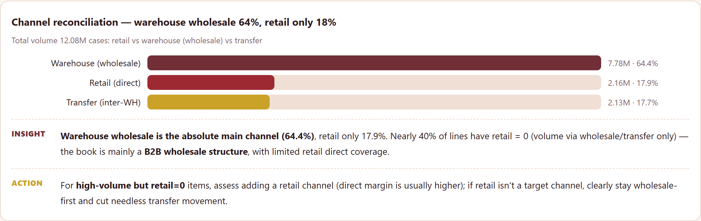
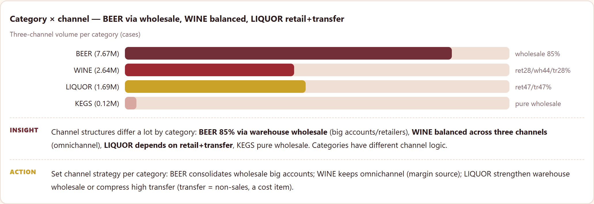
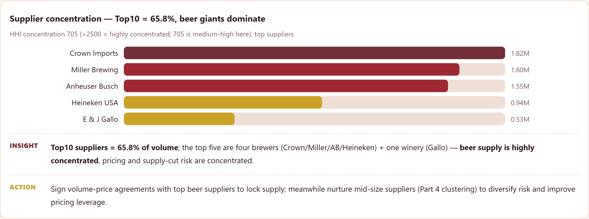
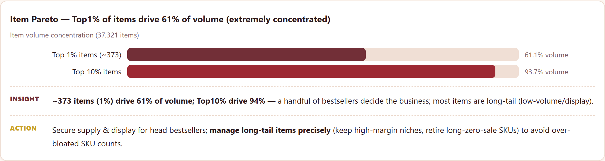
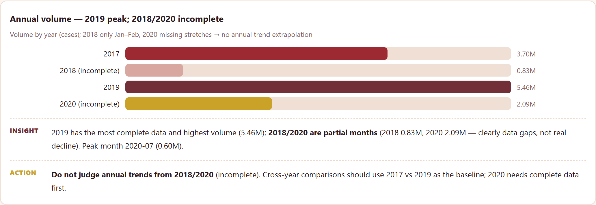

# Liquor Channel — Reconciliation & Sales Performance

**The business problem.** A liquor wholesaler ships through three channels —
**warehouse (wholesale to retailers), retail (direct), and transfers (inter-
warehouse)**. Which channel drives sales, where are the coverage gaps, and is
supply dangerously concentrated? This project reconciles the channels and
profiles categories/suppliers on **real** Ohio liquor sales data (307,645 rows,
37,321 items, 397 suppliers, 2017–2020).

## What it does

- **Channel reconciliation**: warehouse 64.4% / retail 17.9% / transfer 17.7%;
  ~39.6% of rows have zero retail sales (coverage gap).
- **Category × channel**: BEER is 85% wholesale; WINE is balanced across all
  three; LIQUOR relies on retail + transfer; KEGS is pure wholesale.
- **Supply concentration**: Top 10 suppliers = 65.8% of volume (HHI 705), led by
  beer giants (Crown Imports, Miller, Anheuser Busch, Heineken) + Gallo.
- **Item Pareto**: top 1% of items = 61% of volume; top 10% = 94%.
- **Supplier clustering** (KMeans, no labels): large wholesale / mid-balanced /
  small warehouse / retail-focused.

## Charts







> Full interactive report: open `index.html` (English) or `index.zh-CN.html` (Chinese) after cloning — GitHub doesn't render HTML.

## Honest notes

- **Monthly data is incomplete** (2018 = only Jan–Feb, 2020 missing stretches; 24
  usable months). Class-level monthly forecasting gives **negative R² (mean -1.89)**
  — worse than predicting the mean. **I do not use forecasts as recommendations**
  and say so; the report is a structural diagnostic, not a time-series extrapolation.
- Some categories carry **negative values** (returns/adjustments, e.g. OTHER -142K)
  — identified, not treated as main business.
- **No deep learning**: few monthly points, no learnable sequence; clustering +
  statistics are interpretable and deployable.

## Key verified numbers

- 307,645 rows / 37,321 items / 397 suppliers / 7 categories
- Total 12.08M units: warehouse 7.78M (64.4%), retail 2.16M (17.9%), transfer 2.13M (17.7%)
- 39.6% rows retail = 0; 2019 full-year peak 5.46M; peak month 2020-07 (0.60M)
- Top10 suppliers 65.8%; item top1% 61.1%, top10% 93.7%
- Supplier clusters: 4 (large wholesale / mid / small / retail)

## Data source

Raw data lives in `data/raw/` (excluded from git — after cloning, download it yourself).

| File | What it is | Kaggle download |
|---|---|---|
| `Warehouse_and_Retail_Sales.csv` | Ohio liquor sales, 307,645 rows (2017–2020) | `kaggle datasets download -d lalit7881/warehouse-and-retail-sales -p data/raw --unzip` |

Kaggle page: https://www.kaggle.com/datasets/lalit7881/warehouse-and-retail-sales

```bash
pip install kaggle
kaggle datasets download -d lalit7881/warehouse-and-retail-sales -p data/raw --unzip
# requires a kaggle.json / KAGGLE_USERNAME + KAGGLE_KEY
```

## Run

```bash
pip install -r requirements.txt
python scripts/clean_data.py
python scripts/analyze.py
python scripts/ml_analysis.py
pytest tests/ -q
```

## Layout

```
scripts/ clean_data.py / analyze.py / ml_analysis.py
tests/   test_cleaning.py, test_report_numbers.py
index.html   # English interactive report
index.zh-CN.html  # Chinese report (burgundy-gold theme, each chart Insight+Action)
```

— Jiawei Wang
