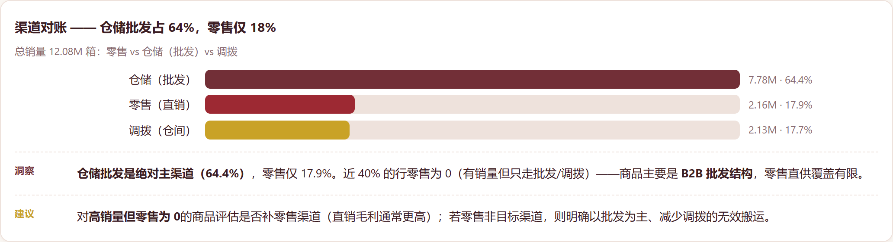
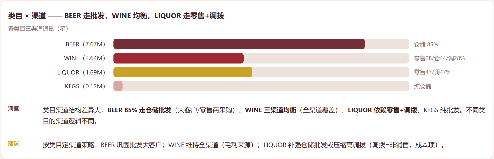
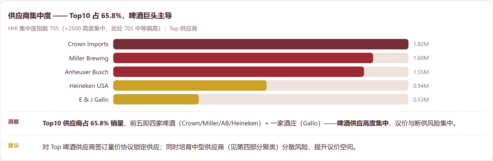
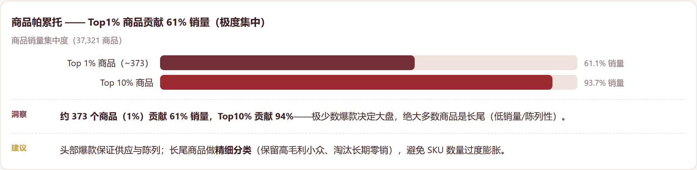
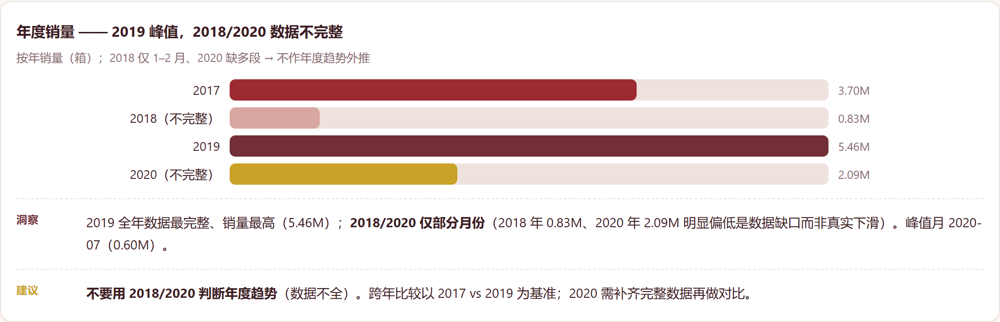

# 酒类渠道对账与销售绩效分析（Liquor Channel Reconciliation & Sales Performance）

> 项目目标：酒类批发商走三条渠道——**仓储批发（批发给零售商）、零售（直销）、调拨（仓间）**。哪条渠道拉动销售、覆盖缺口在哪、供应是否过度集中？本项目在真实俄亥俄州酒类销售数据（307,645 行，37,321 个商品，397 家供应商，2017–2020）上做渠道对账与品类/供应商画像。

## 一、业务背景与目的

酒类批发商同时走仓储批发、零售、调拨三条渠道，却常看不清：哪条渠道真正拉动销售、哪些区域/品类存在零售覆盖缺口、供应端是否被少数巨头垄断。本项目量化这三件事，给出渠道与供应商管理建议。

## 二、做了什么

- **渠道对账**：仓储批发 **64.4%** / 零售 **17.9%** / 调拨 **17.7%**；约 39.6% 的行零售为 0（覆盖缺口）。
- **类目 × 渠道**：BEER 85% 走批发；WINE 三渠道均衡；LIQUOR 依赖零售+调拨；KEGS 纯批发。
- **供应集中度**：Top10 供应商占 **65.8%**（HHI 705），由啤酒巨头主导（Crown Imports、Miller、Anheuser Busch、Heineken）+ Gallo。
- **商品帕累托**：Top1% 商品贡献 **61%** 销量；Top10% 达 94%。
- **供应商聚类（KMeans，无标签）**：大批发型 / 中型均衡 / 小型仓储型 / 零售聚焦型，共 4 组。

## 三、图表







> 完整交互版报告：`report/酒类渠道对账与销售绩效分析.html`——GitHub 不渲染仓库内 HTML，clone 后本地打开。

## 四、诚实说明

- **月度数据不完整**（2018 只有 1–2 月，2020 缺一段；仅 24 个可用月份）。品类级月度预测给出 **负 R²（均值 -1.89）**——比预测均值还差。**我不把预测当建议**，如实说明；报告是结构诊断，不是时间序列外推。
- 部分类目含**负值**（退货/调整，如 OTHER -142K）——已识别，不作为主营业务处理。
- **不用深度学习**：月度样本少、无可学习序列；聚类 + 统计可解释、可落地。

## 五、关键数字

- 307,645 行 / 37,321 商品 / 397 供应商 / 7 类目
- 总量 12.08M 件：仓储 7.78M（64.4%）、零售 2.16M（17.9%）、调拨 2.13M（17.7%）
- 39.6% 行零售 = 0；2019 全年峰值 5.46M；峰值月 2020-07（0.60M）
- Top10 供应商 65.8%；Top1% 商品 61.1%、Top10% 93.7%
- 供应商聚类 4 组（大批发 / 中型 / 小型 / 零售）

## 六、数据来源

原始数据在项目内 `data/raw/`（不入 git——clone 后请自行下载）。

| 文件 | 说明 | Kaggle 下载 |
|---|---|---|
| `Warehouse_and_Retail_Sales.csv` | 俄亥俄州酒类销售，307,645 行（2017–2020） | `kaggle datasets download -d lalit7881/warehouse-and-retail-sales -p data/raw --unzip` |

Kaggle 页面：https://www.kaggle.com/datasets/lalit7881/warehouse-and-retail-sales

```bash
pip install kaggle
kaggle datasets download -d lalit7881/warehouse-and-retail-sales -p data/raw --unzip
# 需要 kaggle.json / KAGGLE_USERNAME + KAGGLE_KEY 认证
```

## 七、运行方式

```bash
pip install -r requirements.txt
python scripts/clean_data.py
python scripts/analyze.py
python scripts/ml_analysis.py
pytest tests/ -q
```

## 八、目录结构

```
scripts/ clean_data.py / analyze.py / ml_analysis.py
tests/   test_cleaning.py, test_report_numbers.py
report/   酒类渠道对账与销售绩效分析.html  （勃艮第红+金配色，每个图表 Insight+Action）
```

— Jiawei Wang
